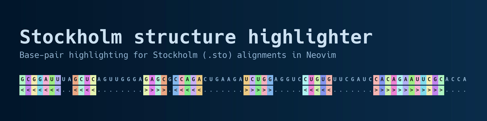
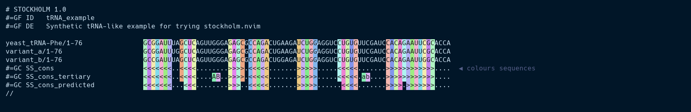
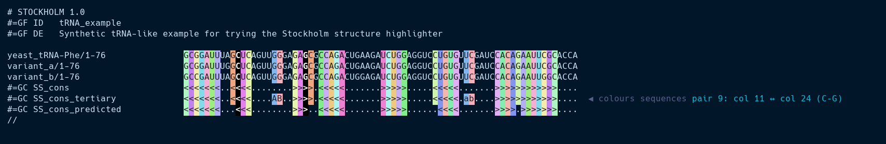

<p align="center">
  
</p>

<p align="center">
  <a href="https://github.com/TylerIllman/Stockholm-structure-highlighter/actions/workflows/ci.yml"></a>
  <a href="LICENSE"></a>
  
  
  <a href="https://github.com/TylerIllman/Stockholm-structure-highlighter/stargazers"></a>
  <a href="https://github.com/TylerIllman/Stockholm-structure-highlighter/commits/main"></a>
</p>

Reading a secondary-structure line like `<<<<___AAA_>>>>` and working out which base closes which
pair is slow. This plugin reads the `#=GC SS_cons*` lines in the file, works out every base pair, and
colours both partners the same way, on the structure line and in every sequence at those columns.



Putting the cursor on a paired base highlights it and its partner in every sequence, and prints the pair on the structure line:



The example above is [examples/trna.sto](examples/trna.sto). It is synthetic data you can open to try the plugin.

## Features

- Every base pair gets its own colour (120 distinct hues), so an opener and its closer are easy to match.
- Colours belong to the pair itself, so a pair that appears in several structure lines keeps one colour across all of them. Only pairs that differ between lines get new colours, which makes differences between structures easy to spot.
- The colour numbering is anchored to the structure line you are on (or the default one, the first line with pairs). Its pairs get the colours in order, and pairs found only in other lines get new colours after them.
- An optional `stem` mode gives each helix a single colour instead.
- Handles the WUSS bracket types `<>`, `()`, `[]`, `{}` and pseudoknot letters `Aa` to `Zz`.
- Handles files with many alignments (one per `//`), several structure lines per alignment (for example
  `SS_cons_Rfam_*`, `SS_cons_CaCoFold_*`, `SS_cons_RNAview_*`), and interleaved blocks.
- Putting the cursor on a paired base highlights that base and its partner in every sequence.
- A readout on the structure line shows the pair, for example `pair 14: col 45 ↔ col 88 (G–C)`.
- `gp` jumps to the partner of the base under the cursor.
- Only the visible lines are drawn, so large full alignments stay fast.

## Requirements

- Neovim 0.10 or later.

## Installation

With [lazy.nvim](https://github.com/folke/lazy.nvim):

```lua
{
  "TylerIllman/Stockholm-structure-highlighter",
  lazy = false, -- the plugin registers the stockholm filetype, so it must load at startup
  opts = {}, -- see Configuration
}
```

With [packer.nvim](https://github.com/wbthomason/packer.nvim):

```lua
use { "TylerIllman/Stockholm-structure-highlighter" }
```

The plugin registers the `stockholm` filetype for `*.sto`, `*.stk` and `*.stockholm`. No setup call is
needed unless you want to change the defaults.

## Usage

Open a Stockholm file. Paired bases are coloured immediately.

| Key  | Action                                                        |
| ---- | ------------------------------------------------------------- |
| `gp` | Jump to the base paired with the one under the cursor.        |
| `]s` | Colour the sequences by the next `SS_cons*` line.             |
| `[s` | Colour the sequences by the previous `SS_cons*` line.         |

| Command           | Action                                              |
| ----------------- | --------------------------------------------------- |
| `:StockholmNext`  | Same as `]s`.                                       |
| `:StockholmPrev`  | Same as `[s`.                                       |

### Which structure colours the sequences?

Each `SS_cons*` line is always coloured by its own pairs. The sequences use one "active" structure
line, marked with `◀ colours sequences` at the end of the line. By default that is the first line in the
alignment that contains pairs. Moving the cursor onto another structure line makes it the active one, or
you can cycle with `]s` and `[s`. The choice is remembered per alignment.

## Configuration

Defaults:

```lua
require("stockholm").setup({
  -- "pair": one colour per base pair. "stem": one colour per helix.
  color_mode = "pair",
  -- Buffer-local mappings. Set an entry to false to skip it, or `mappings = false` for none.
  mappings = {
    next_structure = "]s",
    prev_structure = "[s",
    goto_partner = "gp",
  },
})
```

You can also switch colour mode on the fly with `:let g:stockholm_color_mode = "stem"`.

### Highlight groups

| Group            | Used for                                                              |
| ---------------- | --------------------------------------------------------------------- |
| `StoPair1`..`StoPair120` | The pair colours. Override any of them in your colourscheme.  |
| `StoPairCursor`  | The base under the cursor and its partner (black background, bold).   |
| `StoActive`      | The `◀ colours sequences` note (links to `Comment`).                  |
| `StoReadout`     | The pair readout (links to `DiagnosticInfo`).                         |

All groups are defined with `default = true`, so your own definitions win.

## How it works

For each `//`-terminated alignment the plugin stitches together the `SS_cons*` segments across blocks and
pairs brackets with one stack per bracket type. Highlights are drawn with a decoration provider using
ephemeral extmarks, so nothing is stored in the buffer and only on-screen lines are processed.

## Limitations

- Only `#=GC SS_cons*` lines and `#=GR <seq> SS` lines are read. Other markup lines are ignored.
- A `//` line ends an alignment. Pairs never span alignments.

## Development

```sh
nvim --headless -u NONE -l tests/run.lua
```

The tests need no dependencies. Issues and pull requests are welcome.

## License

MIT. See [LICENSE](LICENSE).
